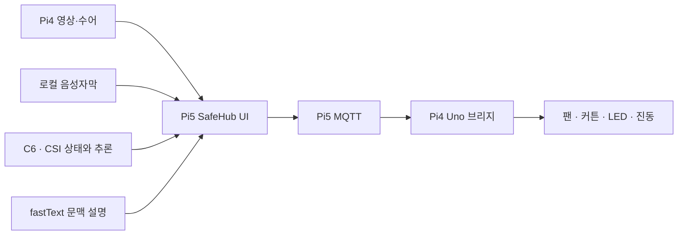

# SafeHub · 멋쟁이들

청각장애인 사용자가 집 안의 음성 안내와 위험 정보를 **자막·화면·수어·촉각 알림**으로
확인하고 응답하도록 돕는 스마트홈 프로젝트입니다.
2026 임베디드소프트웨어 경진대회 LG전자 부문 제출을 준비하고 있습니다.

## 현재 제품 구성

- **방송·재난 안내:** 확정 음성자막의 위험 표현과 재난 원문을 화면에 표시하고 수어·터치로 확인합니다.
- **수어·도움 요청:** 카메라와 수어 결과를 표시하고 도움 요청 문안을 준비합니다. 실제 신고·연락 전송은 연결하지 않았습니다.
- **재실·활동 상태:** CSI의 최신 상태와 기존 모델의 행동 예측을 확인합니다. 움직임만으로 부재·의식 상태를 확정하지 않습니다.
- **팬·커튼·경보:** 팬·커튼과 수어 단축키, 기존 LED·진동 경보 경로를 유지합니다. 명령 제출과 실제 물리 동작 확인은 구별합니다.
- **문맥 설명:** fastText와 규칙으로 자막·사건 문맥을 설명합니다. 경보·도움 화면은 설명 서버를 기다리지 않습니다.

수집·학습·시나리오·장치 시험은 개발 모드로 분리했습니다.
일반 UI의 원본은 **[SW/safehub_scenario](SW/safehub_scenario/README.md)** 하나입니다.
옛 UI·독립 과거 앱·생성형 서버·미사용 실행 파일은 정리했고, 필요한 수어 기준 코드와 회귀 자료는 보존했습니다.



위 그림은 소스 구성입니다. 실제 장치 전체 흐름의 검증 상태는 아래의 검증 기록을 확인하세요.

## 장비 없이 화면 확인

Python 3.12와 Flutter **3.35.7 / Dart 3.9.2**가 준비된 PC에서 저장소 루트 기준으로 실행합니다.
호스트용 복사본을 임시 폴더에 만들며 실제 장치에는 연결하지 않습니다.

```sh
python3 SW/safehub_scenario/tool/run_ui_preview.py --check-only
python3 SW/safehub_scenario/tool/run_ui_preview.py
```

Flutter가 PATH에 없으면 `--flutter-path <Flutter 실행 파일>`을 지정합니다.
기본 화면은 제품 모드이며, 시연·개발 도구가 필요할 때만 `--developer-tools`를 추가합니다.
[화면 실행 안내](SW/safehub_scenario/docs/scenario-event-overlays.md)와
[Windows 개발 호스트](SW/windows_preview/README.md)를 참고하세요.
실제 연결용 빌드는 `APP_LOCAL_PREVIEW=false`, `SAFEHUB_DEVELOPER_TOOLS=false`가 기본입니다.
개발 도구 노출 스위치와 실제 I/O 허용은 서로 다릅니다.

## 개발과 검사

SDK·빌드·개인 설정·기록·모델은 저장소 밖에 둡니다. 새 외부 폴더에 현재 UI 전체를 준비합니다.

```sh
python3 -m unittest discover -s SW/safehub_scenario/tool -p 'test_*.py' -v
python3 SW/safehub_scenario/tool/prepare_host_tests.py /tmp/safehub-scenario-host
cd /tmp/safehub-scenario-host
flutter pub get --enforce-lockfile
flutter test --no-pub
```

호스트 준비는 ATLAS path 플러그인 두 개만 제외하며 제품 Dart 소스·테스트·자산을 그대로 복사합니다.
검증한 [host lock](SW/safehub_scenario/tool/host_pubspec.lock)으로 의존성을 고정합니다.
ATLAS용 runner·manifest·record_atlas는 `SW/safehub_scenario`에 있으며 실제 ATLAS 빌드에는 팀 SDK가 필요합니다.

[GitHub 검사 workflow](.github/workflows/source-checks.yml)는 비장비 계약·호스트 C++·Flutter·제품 web 빌드를 검사하도록 구성했습니다.
실제 서버로 가짜 사건을 보내던 옛 파일은 제거했고 허브 검사는
[승인된 비장비 목록](tools/run_hub_checks.py)을 Python 네트워크 연결 차단 상태에서 실행합니다.

## 소스 위치

| 경로 | 역할 |
|---|---|
| `SW/safehub_scenario` | 현재 UI·runner·플러그인·자산·검사·호스트 도구 |
| `SW/rpi4_sign_cpp`, `SW/rpi4_vision_atlas` | 현재 수어·비전 소스 후보와 회귀 검사 |
| `SW/rpi5_hub`, `SW/uno_bridge` | 수어 단축키·MQTT·Uno 명령 경로 |
| `SW/local_stt`, `SW/fasttext_context` | 음성자막·fastText 문맥 서비스 |
| `SW/wifi_sensing` | 제품 상태·기존 모델 선택·추론; 별도 개발용 수집·학습 |
| `SW/atlas_boot` | 검토용 제품 부팅 구성; 장치에 적용하지 않음 |
| `HW/esp32_csi` | C6 송수신 소스·라이선스; 빌드/플래시 미실행 |
| `tools`, `SW/windows_preview` | 회귀·검사·Windows 개발 도구 |

## 검증과 제출 상태

직접 실행한 최신 결과는 Flutter **272 pass / 0 fail / 1 실제 fastText opt-in skip**입니다.
문맥/HTTP 9개, Uno 계약 15개, 수어 프레임/진단 Python 22개와 기타 비장비 검사를 통과했습니다.
허브는 unittest 개수와 구별해 **14개 assertion 스크립트**를 실행했습니다. C++ 호스트 회귀는 19개입니다.
정적 분석은 error 0 / warning 0 / info 103이며 기본 명령은 exit 1입니다.
CI는 스타일 info를 출력하면서 error·warning을 실패로 처리합니다.

현재 작업은 [기존 Draft PR #11](https://github.com/minbeom77/2026ESWContest_smart_mutjaengideul/pull/11)에 있습니다.
main/develop에는 직접 반영하지 않았습니다. **제출 전에 제출 대상 브랜치와 PR 검토·병합 여부를 확인해야 합니다.**
[제출 확인 안내](docs/SUBMISSION.md), [최신 점검 기록](docs/integration/submission-audit-20261027.md)을 기준으로 확인하세요.

앱 ID는 `com.atlas.app.safehub_scenario_pr7`, Dart package/binary는 `safehub_app`, 후보는 1.4.0+1입니다.
1.2.0은 과거 사용자 확인, 1.4.0 설치는 #10 작성자 보고입니다. 현재 장치 실행본·설정·IPK·실제 모델·보관본은
클라우드에서 **미확인/미확보**입니다. ATLAS 빌드·재부팅·마이크→장치·모터·모델 정확도는 검증하지 않았습니다.

## 계약·출처·복원

- [MQTT 계약](config/topics.json), [제품 범위와 실행 플래그](docs/integration/product-scope-20261027.md)
- [외부 소스·라이선스](THIRD_PARTY_NOTICES.md), [협업 규칙](CONTRIBUTING.md)
- [정리 전 GitHub 백업](https://github.com/minbeom77/2026ESWContest_smart_mutjaengideul/tree/backup/pr11-before-product-cleanup-20261027): 소스 압축본의 847개 파일이 원본과 일치함을 복원 검사했습니다.

개인 기록·인증정보·설정·SDK·모델 보관본을 Git에 무차별로 추가하지 않습니다.
