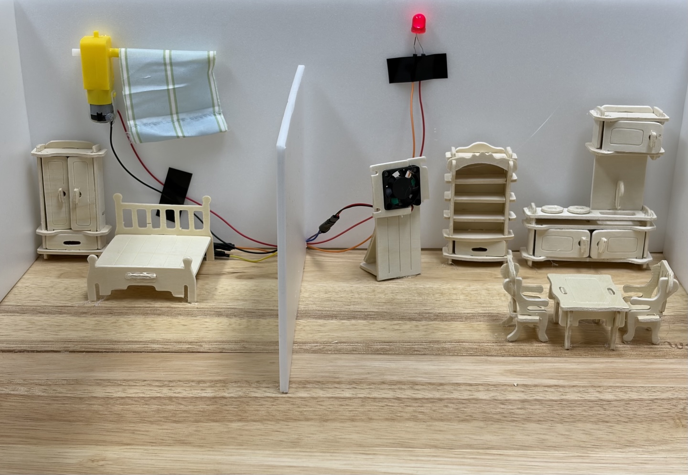
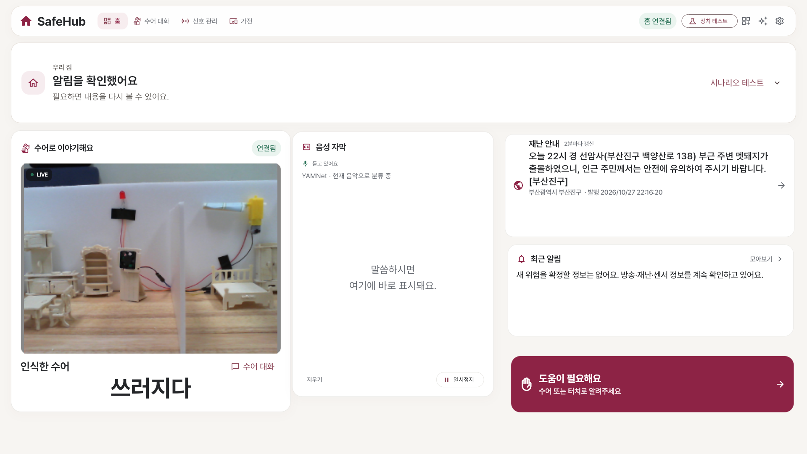
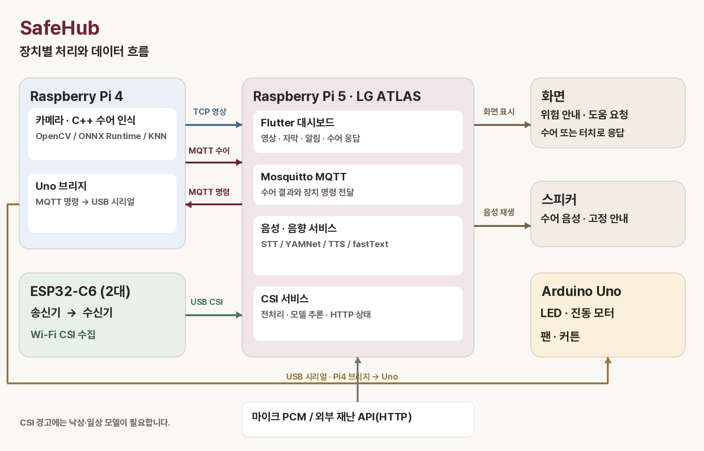
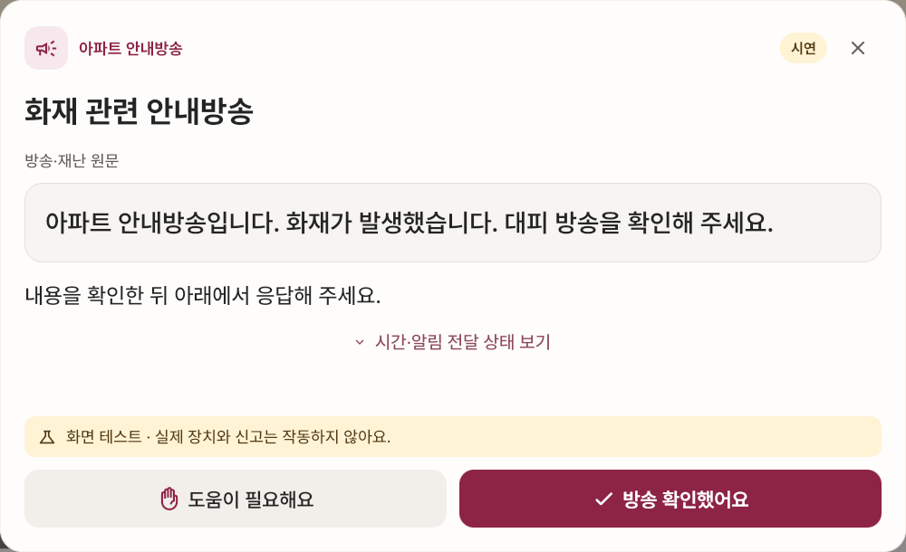
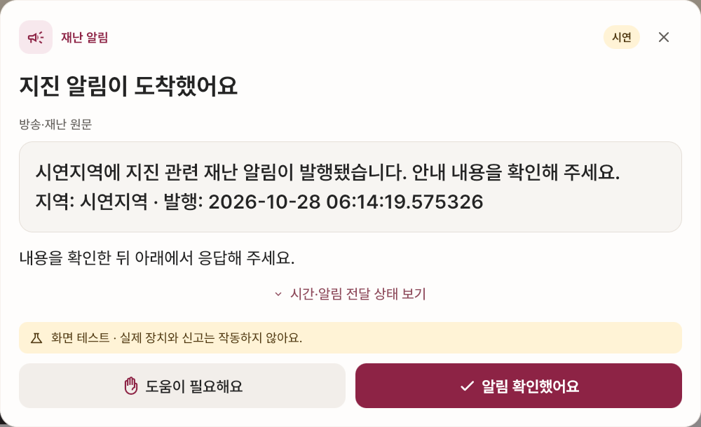
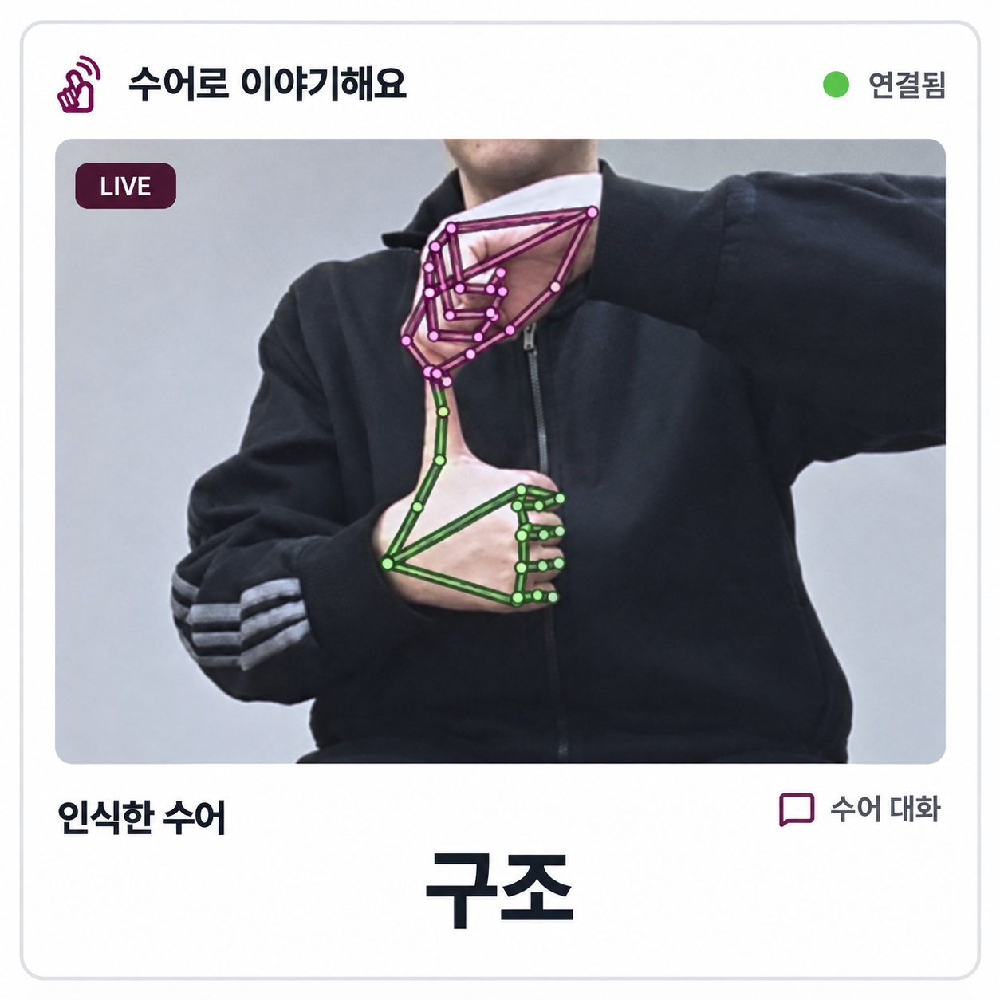
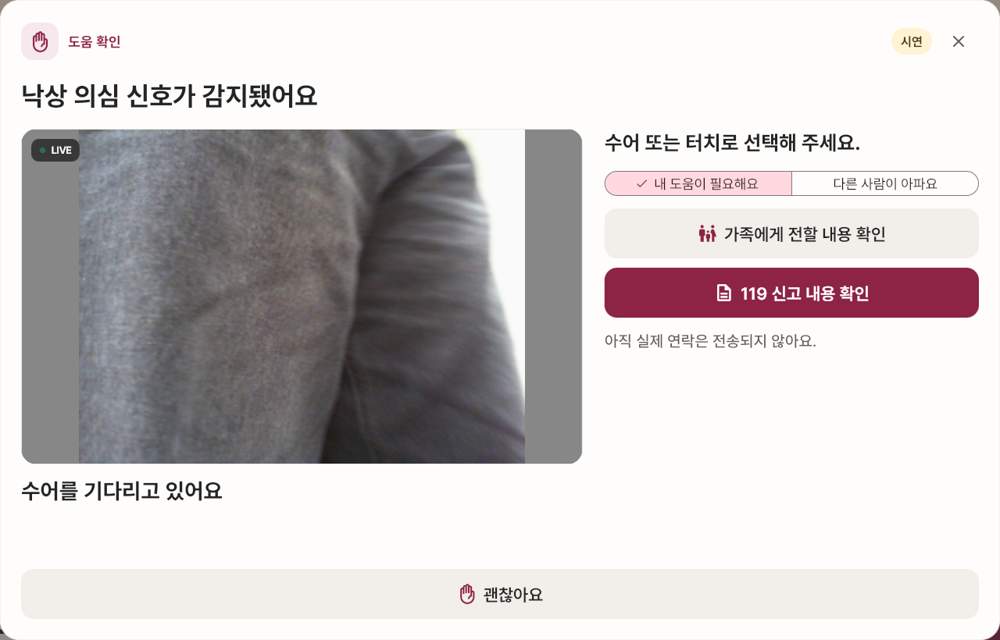

<div align="center">

# SafeHub

### 수어 번역 및 Wi-Fi CSI 센싱 기반 배리어프리 하우스

청각·언어장애인의 기기 제어와 위험 알림을 돕는 배리어프리 스마트홈

**제24회 임베디드SW경진대회 · 스마트 가전 · 영남대학교 멋쟁이들**

</div>

<table>
<tr><th width="50%">실물 시제품 · 시연 영상 촬영</th><th width="50%">대시보드 · 발표 자료 UI 예시</th></tr>
<tr><td></td><td></td></tr>
</table>

[시연 영상 보기](https://youtu.be/lYaKvy8eugI)

## 프로젝트 소개

“음성으로 기기를 부르기 어렵다면, 스마트홈을 어떻게 사용할 수 있을까?”

SafeHub는 사전 설명회에서 본 음성 호출 기능을 계기로 시작했습니다. 음성 호출을 대신할 수어 입력을 만들고, 듣기 어려운 방송과 경보를 자막·LED·진동으로 전달하고자 했습니다.

사용자는 카메라 앞에서 수어로 기기를 제어하거나 도움을 요청할 수 있습니다. 위험 알림이 도착하면 화면에서 내용을 읽고 수어 또는 터치로 응답합니다.

## 주요 기능

| 기능 | 설명 |
|---|---|
| 수어 인식 | 기본 15종 단어를 인식해 기기 제어·도움 요청에 연결합니다. ‘쓰러지다’ 등 추가 단어는 별도 참조 데이터로 확장합니다. |
| 실시간 음성 자막 | 아파트 안내방송과 주변 음성을 한국어 자막으로 보여줍니다. |
| 경보음 감지 | 사이렌·화재경보음의 음향 분석 결과를 화면 알림에 연결합니다. |
| 재난정보 안내 | 재난 API에서 받은 안내의 내용·지역·발행 시각을 표시합니다. |
| Wi-Fi CSI | 카메라 없이 수집한 무선 신호를 분석하고, 낙상 의심 결과를 상태 확인 화면에 연결합니다. |
| LED·베드셰이커 | 위험 알림을 LED와 침대 모형 아래 진동 모터로 전달합니다. |
| 가전 제어 | 수어 단축키와 화면 버튼으로 팬·커튼을 조작합니다. |
| 음성 출력 | 인식한 수어를 음성으로 전달하고, 긴급 상황에서는 준비된 안내 음성을 재생합니다. |

## 시스템 구성



Pi4는 카메라와 수어 인식을, Pi5는 화면과 서비스 통합을 담당합니다. 영상은 TCP로 전송하고 수어 결과와 장치 명령은 MQTT로 주고받습니다. C6 수신기의 CSI는 USB 시리얼로 Pi5에 전달하며, Uno는 Pi4 브리지를 통해 실물 장치를 제어합니다.

<details>
<summary><b>하드웨어·소프트웨어 구성 보기</b></summary>

### 하드웨어

| 구성 | 역할 |
|---|---|
| Raspberry Pi 4 | 카메라 입력, 손 검출·수어 분류, 영상 전송, Uno 통신 |
| Raspberry Pi 5 | LG ATLAS 기반 대시보드, MQTT 브로커, 음성·음향·CSI 서비스 |
| ESP32-C6 송신기·수신기 | Wi-Fi CSI 송수신 |
| Arduino Uno | 팬·커튼·LED·진동 모터 제어 |
| USB 카메라·마이크·스피커 | 수어 영상, 방송 입력, 음성 출력 |

에어컨 제어는 팬으로, 베드셰이커는 침대 모형 아래의 진동 모터로 구현했습니다.

### 소프트웨어

| 구성 | 사용 기술 | 처리 내용 |
|---|---|---|
| 수어·영상 | C++17, OpenCV, ONNX Runtime, KNN | 손바닥 검출 → 손 관절 추출 → 동작 구간 분류 |
| 대시보드 | Flutter, Dart, Pretendard | 카메라·자막·재난 안내·도움 요청·기기 제어 |
| 음성 인식 | sherpa-onnx, 한국어 Zipformer, Kiwi | 스트리밍 자막과 띄어쓰기 보정 |
| 경보음 분석 | YAMNet, LiteRT | 공유 마이크 PCM에서 경보음 분류 |
| 음성 출력 | edge-tts, 내장 MP3 | 일반 문장 합성·긴급 고정 안내 |
| CSI | Python, NumPy, PyWavelets, scikit-learn, PyTorch | 신호 전처리, 모델 학습·추론, 낙상 판정 |
| 통신·제어 | Mosquitto, MQTT, TCP, HTTP, USB 시리얼 | 장치 간 데이터 전달과 실물 제어 |
| 문맥 설명 | fastText, 문장 규칙 | 방송 원문에 근거한 짧은 상황 설명 |


</details>

## 시연 시나리오

### 01. 아파트 방송과 경보음

사이렌을 분석하거나 “화재가 발생했습니다”라는 방송을 자막으로 인식하면 화면에 알림을 표시합니다. LED와 베드셰이커가 함께 작동해 사용자가 상황을 확인하도록 돕습니다.



<sub>화재 안내 화면 · 발표 자료 UI 예시</sub>

### 02. 외부 재난정보

재난 API에서 받은 지역과 안내 내용을 화면에 표시합니다. 시연에서는 API 응답 형식의 모의 데이터를 사용해 재난 알림과 LED·진동의 연결을 보여줍니다.



<sub>지진 모의 알림 화면 · 발표 자료 UI 예시</sub>

### 03. 수어로 상태 응답과 도움 요청

낙상 의심 알림이 표시되면 사용자는 ‘괜찮다’ 수어로 응답하거나 도움 요청 화면으로 이동합니다. 센서 알림이 없어도 ‘아프다’, ‘구조’ 등의 수어로 도움을 요청할 수 있습니다.

<table>
<tr><th width="40%">수어 인식 결과 · 발표 자료 UI 예시</th><th width="60%">도움 요청 화면 · 발표 자료 UI 예시</th></tr>
<tr><td></td><td></td></tr>
</table>

낙상 시연은 모의 이벤트 이후의 대응 과정을 보여줍니다. 119 기능은 신고 문안과 영상 화면의 시연까지이며 실제 신고는 전송하지 않습니다.

## 구현하면서 해결한 문제

### 카메라 화면의 지연 누적

영상 수신보다 추론이 느리면 이전 프레임이 쌓여 현재 동작이 뒤늦게 보였습니다. 촬영과 추론을 분리하고, 추론에는 최신 프레임을 전달하도록 바꿨습니다. 영상 전송과 Pi5 화면 디코딩에서도 대기 프레임을 제한했습니다.

### 손이 가려질 때의 수어 판정

양손이 겹치거나 한 손이 잠시 사라지는 구간에서 추적과 분류를 보완했습니다. 현재 프레임에서 검출한 손을 재검출 실패로 잃지 않도록 하고, 불완전한 입력에서는 판정을 보류하도록 했습니다.

### 상황 설명보다 먼저 필요한 알림

느린 문장 생성 때문에 경고까지 늦어지지 않도록 알림과 문맥 설명을 분리했습니다. 경고 화면과 장치 명령은 설명 서버를 기다리지 않고 처리하며, 긴급 음성은 앱에 포함된 파일을 사용합니다.

## 실행 방법

### 화면 미리보기

Python 3.12와 Flutter 3.35.7 / Dart 3.9.2가 준비된 PC에서 실행합니다.

```bash
git clone --branch develop https://github.com/minbeom77/2026ESWContest_smart_mutjaengideul.git
cd 2026ESWContest_smart_mutjaengideul
python3 SW/safehub_scenario/tool/run_ui_preview.py --check-only
python3 SW/safehub_scenario/tool/run_ui_preview.py
```

미리보기는 실제 장치에 연결하지 않습니다. Windows 준비는 [개발 환경 안내](SW/windows_preview/README.md)를 참고하세요.

### 장치 연결

실제 앱은 [ATLAS 빌드 안내](SW/safehub_scenario/README.md)에 따라 준비합니다. 연결 설정에서 MQTT·카메라·STT·TTS·CSI 주소를 지정합니다.

| 서비스 | 기본 포트 | 안내 |
|---|---:|---|
| MQTT | 1883 | Pi5 Mosquitto |
| 카메라 | 5000 | Pi4 TCP 영상 |
| STT | 8766 | [로컬 한국어 자막](SW/local_stt/README.md) |
| CSI | 8765 | [CSI 서비스](SW/wifi_sensing/README.md) |
| TTS | 8000 | [음성 합성 API](SW/tts_server/README.md) |
| 경보음 | 9381 | Pi5 로컬 음향 상태 |
| 문맥 설명 | 9380 | [fastText 서비스](SW/fasttext_context/README.md) |

LG ATLAS SDK 설치본은 저장소에 포함하지 않습니다. 장치 실행에 필요한 SDK와 모델·참조 자료는 각 모듈 안내에 따라 별도로 준비합니다. 일반 TTS와 재난 API는 인터넷 연결이 필요합니다.

## 저장소 안내

| 경로 | 내용 |
|---|---|
| [SW/safehub_scenario](SW/safehub_scenario) | 현재 Flutter 앱 |
| [SW/rpi4_vision_atlas](SW/rpi4_vision_atlas) | 손 검출·관절 추출·영상 전송 |
| [SW/rpi4_sign_cpp](SW/rpi4_sign_cpp) | C++ 수어 분류 |
| [SW/local_stt](SW/local_stt), [SW/yamnet_alarm](SW/yamnet_alarm) | 음성 자막·경보음 분석 |
| [SW/tts_server](SW/tts_server), [SW/fasttext_context](SW/fasttext_context) | 음성 출력·문맥 설명 |
| [SW/wifi_sensing](SW/wifi_sensing), [HW/esp32_csi](HW/esp32_csi) | CSI 처리·C6 펌웨어 소스 |
| [SW/rpi5_hub](SW/rpi5_hub), [SW/uno_bridge](SW/uno_bridge) | 수어 단축키·장치 통신 |
| [config/topics.json](config/topics.json) | MQTT 메시지 규격 |

## 팀원

| 이름 | 담당 |
|---|---|
| [김민범](https://github.com/minbeom77) | Flutter UI, 카메라 연동, 소프트웨어 통합·검증 |
| [이학진](https://github.com/ihakjin125) | 수어 인식, C++ 포팅, 비전·분류 처리 |
| [최명준](https://github.com/MyeongJun725) | MQTT 통신, CSI 연동, 장치 간 서비스 통합 |
| [김희곤](https://github.com/heegon-K) | 하드웨어 제작, 배선, 실물 장치 구성 |

## 검증 현황

| 항목 | 구현 | 확인한 범위 | 추가 평가 |
|---|---|---|---|
| 수어 인식 | 기본 15종·추가 분류 경로 | 선정 수어의 장치 인식 사례 | 단어별 정확도·거리·조명 조건 |
| 방송 자막 | 한국어 스트리밍 STT | 시험 음성과 장치 자막 표시 | 실제 방송·생활 소음 환경 |
| 경보음 알림 | YAMNet·참조 음원 판정 | 지정 사이렌·비상벨의 시연 사례 | 다른 경보음의 오탐·미탐·표시 지연 |
| LED·진동·가전 | MQTT·Uno 제어 | 팀 내부 실물 시연 | 반복 동작·연결 복구 |
| 재난정보 | API 조회·화면 연결 | 실제 수신 기록·모의 재난 대응 | 지역별 조건과 장시간 운전 |
| CSI 낙상 | 수신·전처리·모델 추론·경고 연결 | CSI 수신과 모의 낙상 대응 | 낙상·일상 모델의 실측 정확도 |
| 도움 요청 | 수어·터치 응답·문안 표시 | 도움 화면 시연 | 당사자 사용성 평가 |

### 측정 기록

| 항목 | 결과 | 조건 |
|---|---|---|
| 첫 자막 도착 | **0.780~0.799초** | Pi5 8GB, ATLAS 26.06, 시험 음성을 실제 속도로 전송. 원음 1개와 합성 잡음 변형 1개 |
| 시험 음성 계산 | **1.222~1.254초** | 길이 5.232초의 동일 시험 음성 및 잡음 변형. 실시간 입력 대기 시간은 제외 |

위 값은 2026-10-04 [STT 시험 기록](SW/local_stt/README.md)의 결과입니다. 마이크 발화부터 화면까지의 전체 지연이나 실환경 인식 정확도를 뜻하지 않습니다.

<details>
<summary><b>영상 수신 처리 개선 기록</b></summary>

| 항목 | 개선 전 | 개선 후 |
|---|---:|---:|
| 회차별 처리 시간 중앙값 | 22.62~23.14ms | 2.21~2.74ms |

Windows Dart JIT에서 320×240 RGBA 영상을 자체 송수신한 시험입니다. 각 회차 20프레임 준비 후 120프레임을 측정했으며, 전후 각각 3회 실행했습니다. 카메라 촬영·Pi4 추론·화면 출력은 포함하지 않습니다.

[측정 원자료](docs/wifi-csi/integration-validation/camera-transport-benchmark.json)

</details>

수어 정확도, 반복 시연 성공률, 경보음 입력부터 화면 알림까지의 시간은 아직 별도 수치로 집계하지 않았습니다. CSI 낙상 경고에는 낙상·일상 학습 모델이 필요하며, 경보음 분류만으로 실제 화재를 확정하지 않습니다.

## 라이선스

자체 작성 코드에는 아직 별도의 오픈소스 라이선스를 지정하지 않았습니다. 외부 코드·폰트·라이브러리는 각각의 라이선스를 따릅니다. 자세한 고지는 [THIRD_PARTY_NOTICES.md](THIRD_PARTY_NOTICES.md)를 참고하세요.
